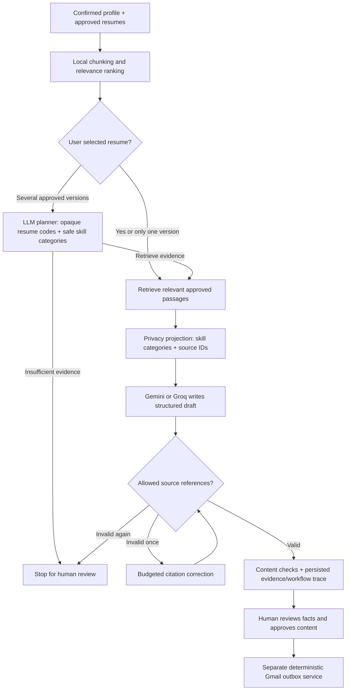

# RAG and bounded agent workflow

## What is implemented

SOL Ai 0.2 uses **local lexical retrieval-augmented generation** and a **bounded LLM planning workflow**. It is not an unrestricted autonomous job-application agent, and it does not use embedding/vector search.

## Retrieval

`src/lib/rag.ts` chunks approved documents into 600-character windows with 100-character overlap, bounded to the first 100,000 characters. Queries are bounded to 128 unique terms, prioritizing role and confirmed skills. A BM25-style lexical score with an explicit job-skill overlap boost ranks passages. Near-overlapping results from the same source are diversified. Up to five evidence references retain document IDs, exact character offsets, passage hashes, relevance and confirmed skill categories.

Corpus: the user's confirmed profile skill list and the selected approved resume. Retrieval queries use target role and pasted opportunity description locally. Relevant approved resumes are ranked by lexical evidence and role alignment. In the multi-resume case, the planner sees at most the top three candidates as opaque R1/R2/R3 codes with role/skill taxonomy summaries.

Retrieval is recomputed at request time for this small personal corpus; there is no persisted vector index, embedding API, or vector database. This is appropriate for a small private resume library but will miss paraphrases and semantic synonyms. Relevance scores are not eligibility scores or hiring probabilities.

## Privacy projection

Raw resume passages, user identity, source filenames, private notes and Gmail content never enter AI requests. Retrieval is local; `providerEvidence()` projects results into a fixed approved skill taxonomy and opaque evidence IDs. The planner receives only the same controlled role/skill categories and temporary candidate codes. Actual signature is appended locally.

This design intentionally limits generation to an evidence-informed expression of interest. It does not synthesize detailed private achievements or pretend to understand every requirement in a posting. It is a privacy-minimized RAG pipeline rather than general-purpose resume question answering.

## Agent boundaries

The LLM planner can choose `retrieve_evidence` for one approved candidate and focus-skill set, or `request_review`. Zod validates the plan; deterministic gates reject unknown candidates, unsupported skills and unlisted tools. User-selected resumes skip LLM planning; a single approved resume needs no planning call.

The writer's tool list contains **no Gmail send, arbitrary network, SQL, code execution or credential-reading capability**. It cannot approve its own output. A missing-evidence decision stops generation and returns a review error. There is no open-ended agent loop.

Citation validation requires at least one unique allowed evidence ID. Invalid citations allow one correction call; quota/rate-limit/provider failures do not cause automatic retries or fallback. Calls have 15-second timeouts, keeping the bounded one-to-three-call path inside the 60-second web-handler budget in normal operation. Upstream latency and database time can still produce a host timeout; no email is sent during generation.

All calls reserve daily budgets independently. A simple single-resume/manual-selection workflow normally uses one generation request. Multi-resume planning adds one request; citation correction can add one more. Usage records distinguish provider/schema execution from final workflow grounding; a successful model response can still be rejected by the later citation gate.

## What citations prove

They prove that the referenced source ID belongs to retrieved approved evidence. They **do not prove semantic entailment of every sentence**, detect all contradictions, or establish an active vacancy. The user still reviews claims, eligibility, recipient and attachment. Editing resets content approval, and the displayed evidence trail is labelled as belonging to original generation.

The Application `intelligence` JSON persists retrieval metadata, citations, selected resume hash and workflow steps. It does not store raw passage copies. The review UI reconstructs the source excerpt from the immutable resume text; if that document is deleted, the trace shows that the original source is unavailable. Completed traces survive restarts; failed pre-draft runs currently return visible errors rather than creating a durable agent-run record.

## Limitations

No embedding/semantic retrieval, detailed claim extraction, general web research agent, durable multi-step agent checkpointing, cross-provider failover, automatic follow-ups or full autonomous routine. End-to-end browser and live-provider verification still require the owner's configured accounts. See `IMPLEMENTATION_STATUS.md` for the complete acceptance matrix.
